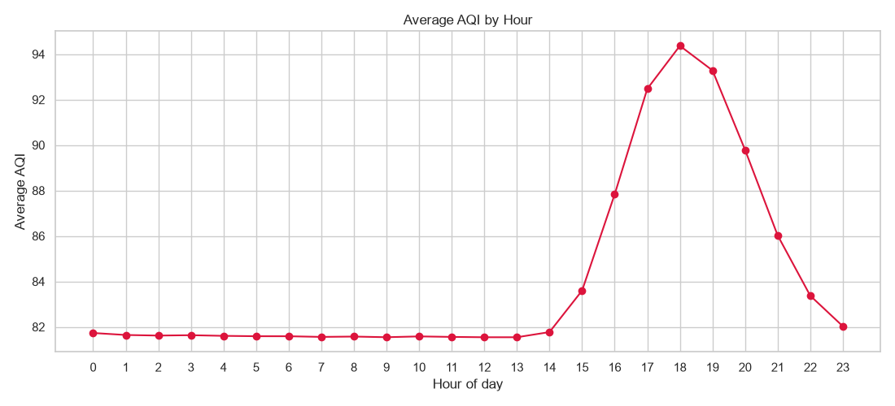
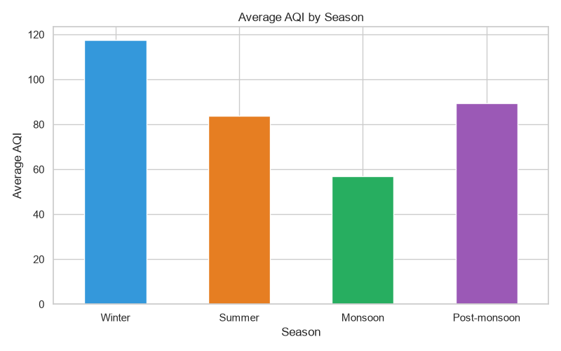
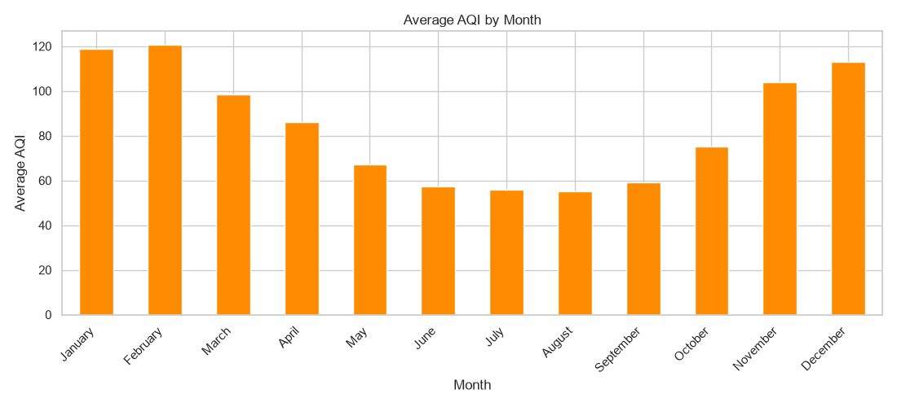
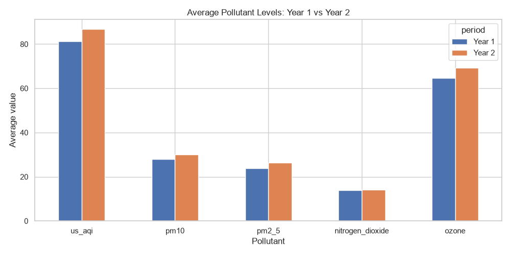
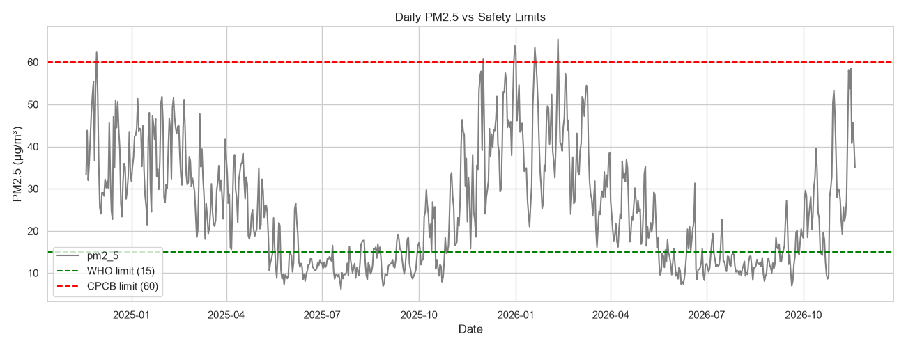
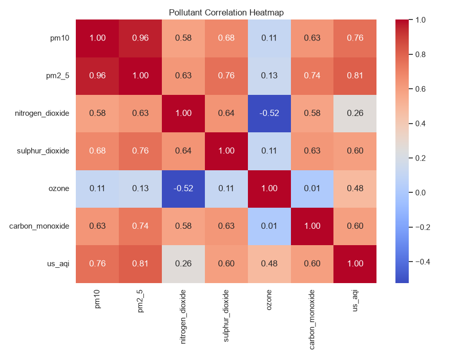

# Kochi Air Quality Analysis (EDA)

Exploratory data analysis of two years of hourly air quality data for Kochi, Kerala, built with Python. The project looks at when and why the air is worst, how it changes by season, and how often it exceeds WHO and Indian (CPCB) PM2.5 limits.

## Key Findings

- **Overall:** average AQI is **84.0**. About **68%** of hours are Moderate, **23%** are Unhealthy for Sensitive Groups, **4%** are Unhealthy, and only **5.5%** are Good.
- **Seasons:** winter is the worst season (average AQI **117.5**) and the monsoon is the cleanest (**56.8**). February is the worst month (120.6) and August the best (55.0).
- **Time of day:** AQI is highest at **18:00** (94.4) and lowest at **12:00** (81.5). Only **59.5%** of hours at 18:00 have acceptable air (AQI of 100 or below), against **77.8%** at 01:00.
- **Weekdays:** there is almost no difference between weekdays (84.2) and weekends (83.6).
- **Year over year:** Year 2 (Nov 2025 to Nov 2026) is slightly worse than Year 1 (Nov 2024 to Nov 2025). Average AQI rose from **81.3 to 86.7 (+6.7%)** and PM2.5 rose by **10.6%**.
- **Health limits:** **66.8%** of days (488 of 731) exceed the WHO daily PM2.5 guideline of 15 µg/m³, but only **1.0%** (7 days) exceed the Indian CPCB limit of 60 µg/m³.
- **Pollutants:** PM2.5 has the strongest link with AQI (r = 0.81), and PM2.5 and PM10 move almost together (r = 0.96). NO₂ and ozone are negatively related (r = -0.52).
- **Worst day:** 23 December 2025, with a daily average AQI of 161.

## Charts

| | |
|---|---|
|  |  |
|  |  |
|  |  |

## Dataset

| | |
|---|---|
| **Period** | 19 Nov 2024 to 19 Nov 2026 |
| **Rows** | 17,544 (one row per hour, no missing hours) |
| **Columns** | `datetime`, `pm10`, `pm2_5`, `nitrogen_dioxide`, `sulphur_dioxide`, `ozone`, `carbon_monoxide`, `us_aqi` |
| **Units** | Pollutants in µg/m³, AQI on the US scale |
| **Source** | Open-Meteo Air Quality API |

**Limitations**
- The values are model-based estimates, not readings from ground sensors.
- There is no station or location column and no weather data (rain, wind, temperature), so explanations such as "rain clears the air in the monsoon" are likely reasons, not proven causes.
- 35 ozone readings are exactly 0. They were kept, as they look like a model floor and not real measurements.

## Questions Answered

The notebook answers 25 questions in five groups:

1. **Overall picture:** AQI distribution, AQI categories, average pollutant levels, PM2.5 distribution and outliers
2. **Time patterns:** hour of day (AQI, NO₂, ozone), weekday, weekday vs weekend, month, season
3. **Trends and bad days:** Year 1 vs Year 2, daily AQI, 30-day rolling average, 10 worst days, days above PM2.5 limits
4. **Pollutant relationships:** correlation heatmap, PM2.5 vs PM10, PM2.5/PM10 ratio by season, NO₂ vs ozone
5. **Deeper insights:** month and hour heatmap, AQI category mix by season, best time of day to go out

## Tools Used

Python, Jupyter Notebook, pandas, NumPy, Matplotlib, Seaborn

## Project Structure

```
kochi-air-quality/
├── data/
│   ├── raw/                  original CSV (not edited)
│   └── processed/            cleaned hourly file and daily summary
├── notebooks/
│   └── 01_kochi_air_quality_eda.ipynb
├── images/
│   └── key_charts/           charts saved from the notebook
├── requirements.txt
└── README.md
```

## How to Run

1. Clone the repository.
2. Install the libraries:
   ```
   pip install -r requirements.txt
   ```
3. Open `notebooks/01_kochi_air_quality_eda.ipynb` in Jupyter or VS Code.
4. Select a Python kernel and choose **Run All**.

## Future Scope

- Merge weather data (rain, wind, temperature) to explain the seasonal patterns
- Forecast next-day AQI with a machine learning model
- Validate the model-based values against ground sensor data
- Compare other cities in Kerala
- Build an interactive Power BI dashboard

## Author

**Aswin Biju**
[LinkedIn](https://www.linkedin.com/in/aswinbiju012) | [GitHub](https://github.com/aswinbiju-analytics)